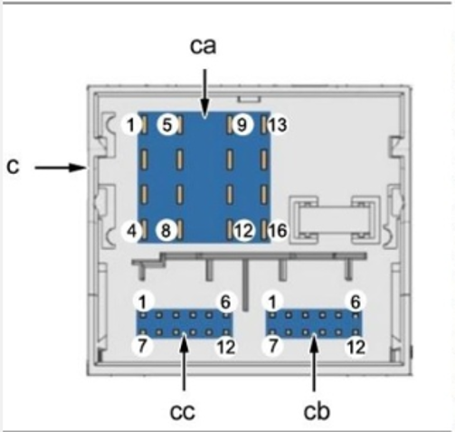

# Conectores das centrais RT6 e RCC AIO Wave 1

Comparativo fornecido pelo mantenedor em **30/10/2026**. Este documento registra os conectores **traseiros das centrais**, identificados como `ca` (16 vias), `cb` (12 vias) e `cc` (12 vias). O [conector da fachada](fachada-rt6-aio.md) tem outro mapeamento.

## Identificação dos blocos e numeração

A imagem enviada mostra `ca` acima, `cc` abaixo à esquerda e `cb` abaixo à direita, na orientação da própria imagem. A origem documental e a indicação formal de vista pelo lado do chicote ou da central não foram fornecidas. Confira as marcações reais para não espelhar a numeração ao observar o outro lado.

**Legenda:** “Não conectado” corresponde a uma indicação explícita na tabela RT6. “Não informado” corresponde a uma célula vazia na tabela AIO; não comprova ausência de função ou terminal. Os nomes de rede reproduzem o mapeamento fornecido: “Comfort CAN” aqui e “Info Div” no mapa da fachada. Isso não estabelece por si só a equivalência de nomes em todas as arquiteturas.

## Bloco ca — 16 vias

| Pino | RT6 | RCC AIO Wave 1 |
| --- | --- | --- |
| 1 | Alto-falante traseiro direito + | Alto-falante traseiro direito + |
| 2 | Alto-falante dianteiro direito + | Alto-falante dianteiro direito + |
| 3 | Alto-falante dianteiro esquerdo + | Alto-falante dianteiro esquerdo + |
| 4 | Alto-falante traseiro esquerdo + | Alto-falante traseiro esquerdo + |
| 5 | Alto-falante traseiro direito − | Alto-falante traseiro direito − |
| 6 | Alto-falante dianteiro direito − | Alto-falante dianteiro direito − |
| 7 | Alto-falante dianteiro esquerdo − | Alto-falante dianteiro esquerdo − |
| 8 | Alto-falante traseiro esquerdo − | Alto-falante traseiro esquerdo − |
| 9 | Alimentação da tela colorida | Não informado |
| 10 | Comfort CAN High | Comfort CAN High |
| 11 | Não conectado | Não informado |
| 12 | Positivo da bateria | Positivo da bateria |
| 13 | Comfort CAN Low | Comfort CAN Low |
| 14 | Não conectado | Não informado |
| 15 | Terra da tela colorida | Não informado |
| 16 | Terra | Terra |

Os pinos de áudio 1–8 e os pinos 10, 12, 13 e 16 têm funções coincidentes nas tabelas fornecidas. Os pinos 9 e 15 do RT6 alimentam a tela externa; o destino desses circuitos na AIO não foi informado. A comparação funcional não comprova intercambiabilidade completa dos chicotes.

## Bloco ca — variante RT6 Hi-Fi

A tabela recebida apresenta esta variante **somente para RT6**. Não foi fornecido um equivalente AIO Hi-Fi.

| Pino RT6 Hi-Fi | Função |
| --- | --- |
| 1 | Não conectado |
| 2 | Saída dianteira direita + para amplificador |
| 3 | Saída dianteira esquerda + para amplificador |
| 4 | Não conectado |
| 5 | Não conectado |
| 6 | Saída dianteira direita − para amplificador |
| 7 | Saída dianteira esquerda − para amplificador |
| 8 | Não conectado |
| 9 | Alimentação da tela colorida |
| 10 | Comfort CAN High |
| 11 | Não conectado |
| 12 | Positivo da bateria de serviço |
| 13 | Comfort CAN Low |
| 14 | Não conectado |
| 15 | Terra da tela colorida |
| 16 | Terra |

A nomenclatura identifica o destino dos sinais. Não foram informados níveis elétricos, impedâncias ou compatibilidade com amplificadores na adaptação AIO.

## Bloco cb — 12 vias

| Pino | RT6 | RCC AIO Wave 1 |
| --- | --- | --- |
| 1 | Terra da disqueteira/CD changer (*) | Não informado |
| 2 | Comfort CAN Low — CD player (*) | Não informado |
| 3 | Alimentação permanente — CD player (*) | Não informado |
| 4 | Áudio direito — CD player (*) | Não informado |
| 5 | Não conectado | Não informado |
| 6 | Comfort CAN High — comando remoto (*) | Não informado |
| 7 | Comfort CAN High — CD player (*) | Não informado |
| 8 | Terra de áudio — CD player (*) | Não informado |
| 9 | Comando de silenciamento MUTE (*) | Não informado |
| 10 | Áudio esquerdo — CD player (*) | Não informado |
| 11 | Comfort CAN Low — comando remoto (*) | Não informado |
| 12 | Não conectado | Não informado |

O asterisco foi preservado da tabela recebida; a nota correspondente não foi fornecida. Todas as células AIO desse bloco estavam vazias. Isso não autoriza classificar o bloco inteiro como sem uso.

## Bloco cc — 12 vias

| Pino | RT6 | RCC AIO Wave 1 |
| --- | --- | --- |
| 1 | Entrada de vídeo 1 + | Não informado |
| 2 | Não conectado | Não informado |
| 3 | Entrada do microfone − | Entrada do microfone − |
| 4 | Entrada de áudio auxiliar direita + | Entrada de vídeo 1 − |
| 5 | Barramento LIN da tela DG4 | Não informado |
| 6 | Entrada de vídeo 2 + | Não informado |
| 7 | Entrada de vídeo 1 − | Não informado |
| 8 | Não conectado | Não informado |
| 9 | Entrada do microfone + | Entrada do microfone + |
| 10 | Entrada de áudio auxiliar esquerda + | Entrada de vídeo 1 + |
| 11 | Entrada de áudio auxiliar − | Não informado |
| 12 | Entrada de vídeo 2 − | Não informado |

## Correspondências por função e diferenças relevantes

| Função | RT6 | AIO Wave 1 | Base da correspondência |
| --- | --- | --- | --- |
| Microfone − | cc/3 | cc/3 | Mesma função na tabela |
| Microfone + | cc/9 | cc/9 | Mesma função na tabela |
| Vídeo 1 + | cc/1 | cc/10 | Mudança de posição na tabela |
| Vídeo 1 − | cc/7 | cc/4 | Mudança de posição na tabela |

**Atenção aos pinos cc/4 e cc/10:** no RT6 são sinais de áudio auxiliar; na AIO recebida são sinais de vídeo. Copiar o bloco cc posição por posição não preserva essas funções.

As correspondências de vídeo descrevem o mapeamento de sinais. Ainda faltam comprovação de formato/nível de vídeo, alimentação e acionamento da câmera, configuração e funcionamento na montagem. A foto da central com aviso na tela não comprova que a câmera esteja funcional. Não foi fornecido um teste individual de cada posição deste comparativo.

Fonte: tabela comparativa e imagem de numeração enviadas pelo autor. O documento preserva as lacunas do levantamento e não estende o pinout para outras revisões de RCC AIO.
