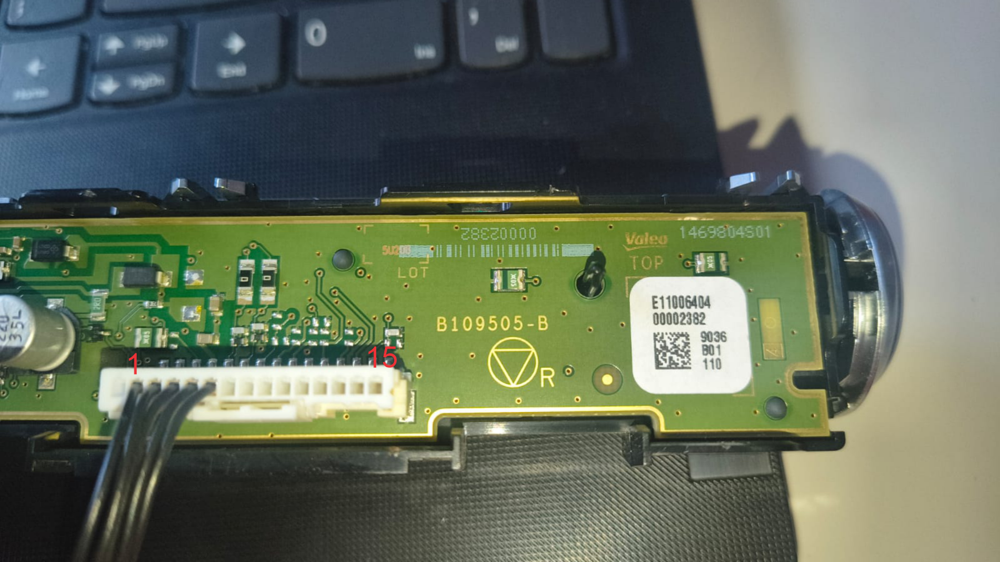
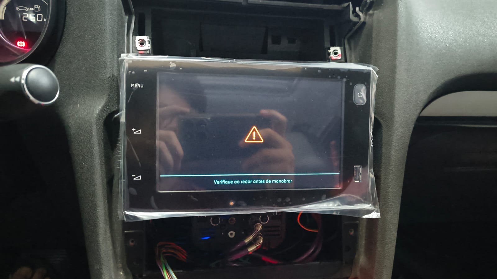

# Fachada AIO no C4 Lounge: montagem e pinout

Relato e mapeamento fornecidos pelo mantenedor em **30/10/2026**, durante a adaptação da RCC AIO ao C4 Lounge. A avaliação de **cerca de 90% funcional** é uma estimativa de uso do autor, não um percentual obtido em ensaio de todas as funções.

## Estado atual da adaptação

Segundo o autor, o único comando da **fachada** que ainda não funciona é o **botão do desembaçador traseiro**. Na **central**, há outra pendência: é possível alterar a temperatura do lado do motorista, mas o ajuste do lado do passageiro não está funcionando.

Essas duas pendências permanecem em investigação. Não foi demonstrado que tenham a mesma causa. O relato não confirma separadamente o funcionamento do indicador do desembaçador. A configuração de climatização da leitura histórica disponível no projeto não comprova a configuração atual dessa montagem.

## Fotos da tentativa

### Placa da fachada e orientação da numeração

A foto enviada pelo autor marca **1 à esquerda e 15 à direita, na vista fotografada da placa e do conector**. Mantenha essa orientação ao comparar o mapeamento: a vista do chicote pelo lado oposto pode ficar espelhada. As inscrições visíveis incluem Valeo e `B109505-B`; são registros da peça fotografada, não uma identificação universal de todas as fachadas AIO.

### Central na montagem de teste

Montagem de teste enviada pelo autor. A imagem mostra um aviso na tela; sozinha, ela não comprova funcionamento da câmera, conclusão da instalação ou causa do aviso.

## Fachada original RT6: funções informadas

| Pino RT6 | Função mapeada pelo autor |
| --- | --- |
| 1 | Terra |
| 2 | Indicador de trava |
| 3 | Sem descrição |
| 4 | Comando liga/desliga do rádio — TOR BSI ON/OFF |
| 5 | Sem descrição |
| 6 | Botão de travamento centralizado |
| 7 | CAN H — rede Info Div |
| 8 | CAN L — rede Info Div |
| 9 | Botão do pisca-alerta |
| 10 | Indicador do pisca-alerta |
| 11 | Iluminação do painel |
| 12 | Alimentação +CAN, pelo fusível F21 |

“+CAN” reproduz a designação fornecida para a alimentação; não representa uma terceira linha de dados CAN. O par de dados é indicado separadamente como CAN H/L. A tabela não informa capacidade de corrente ou condição de chaveamento dessa alimentação.

## Fachada AIO: funções informadas

| Pino AIO | Função mapeada pelo autor | Observação |
| --- | --- | --- |
| 1 | Não utilizado | Classificação informada para esta montagem |
| 2 | Terra | Correspondência RT6 1 |
| 3 | Comando liga/desliga do rádio — TOR BSI ON/OFF | Correspondência RT6 4 |
| 4 | Alimentação +12 V | Correspondência RT6 12 |
| 5 | CAN H — rede Info Div | Correspondência RT6 7 |
| 6 | CAN L — rede Info Div | Correspondência RT6 8 |
| 7 | Não informado | O pino não aparece no mapeamento fornecido |
| 8 | Botão do pisca-alerta | Correspondência RT6 9 |
| 9 | Indicador de trava | Correspondência RT6 2 |
| 10 | Indicador do pisca-alerta | Correspondência RT6 10 |
| 11 | Botão do desembaçador | Função identificada; comando ainda não funcional na adaptação |
| 12 | Botão de travamento centralizado | Correspondência RT6 6 |
| 13 | Indicador do desembaçador traseiro | Funcionamento na adaptação não confirmado separadamente |
| 14 | Possível iluminação | **Hipótese do autor, ainda não confirmada** |
| 15 | Não utilizado | Classificação informada para esta montagem |

## Correspondências RT6 → AIO fornecidas pelo autor

Esta tabela se refere **aos conectores das fachadas**. O [comparativo dos conectores traseiros das centrais](conectores-rt6-aio.md) é outro mapeamento.

| Pino da fachada RT6 | Pino da fachada AIO | Função |
| --- | --- | --- |
| 1 | 2 | Terra |
| 2 | 9 | Indicador de trava |
| 4 | 3 | Liga/desliga do rádio — TOR BSI ON/OFF |
| 6 | 12 | Botão de travamento centralizado |
| 7 | 5 | CAN H — Info Div |
| 8 | 6 | CAN L — Info Div |
| 9 | 8 | Botão do pisca-alerta |
| 10 | 10 | Indicador do pisca-alerta |
| 12 | 4 | Alimentação |

Não foram fornecidas correspondências para RT6 3, 5 e 11. Não foi indicada ligação para AIO 11, 13 ou 14 nessa tabela de adaptação. Em particular, não se deve concluir que RT6 11 deve ser ligado a AIO 14 apenas pela hipótese de iluminação.

## Pendências e próximas evidências

**Desembaçador:** identificar o comportamento elétrico do botão AIO 11 e do indicador AIO 13 e compará-lo com o caminho CAN da fachada original. A [investigação anterior](desembacador.txt) não encontrou pinos BSI validados para uma conexão direta. O circuito de potência do vidro não é uma entrada de botão nem uma saída de indicador.

**Temperatura do passageiro:** registrar a identificação e a leitura atual da AIO e da climatização, a configuração de uma/duas zonas, a resposta da interface aos comandos e o comportamento dos dois lados. Até essa comparação, não há comprovação de que a causa seja um parâmetro B1, a fachada, a central ou a integração com o módulo de climatização.

**Iluminação:** conferir o pino AIO 14 antes de atribuir função ou alimentação. O pino AIO 7 continua sem informação.

Fonte deste documento: fotos, mapeamento e relato do autor. As tabelas registram a unidade e a tentativa descritas; não constituem pinagem universal de todas as fachadas RT6/AIO.
