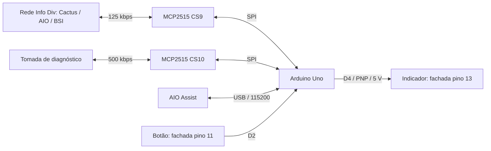

# Meu módulo CAN de climatização para o C4 Lounge

Atualizei este registro em **03/11/2026**. Montei o módulo para usar a RCC AIO com a fachada Cactus e recuperar o ajuste da temperatura do passageiro e o desembaçador traseiro. Na versão híbrida também mantive o acesso ao AIO Assist pela tomada de diagnóstico.

**Confirmei o funcionamento da versão híbrida 3.2 no carro.** Essa confirmação é da minha montagem; não equivale a uma validação de todas as revisões de central, fachada e BSI. Ainda não registrei um ensaio prolongado de temperatura, imunidade a surtos ou compatibilidade eletromagnética.

## O que consegui validar

| Função | O que observei | Alcance da evidência |
| --- | --- | --- |
| Temperatura do passageiro | O comando na AIO alterou a consigna e senti a diferença nas saídas de ar | Validei no carro; não medi a temperatura com instrumento |
| LO, HI e faixa intermediária | Corrigi o limite que impedia ultrapassar 22,5 °C; consegui usar os extremos | Validei no carro; os códigos CAN não são uma escala linear em graus |
| AC MAX da fachada | Passei a colocar também o passageiro em LO | Validei no carro; ao sair de MAX, o firmware restaura a consigna anterior |
| Desembaçador via CAN | Ouvi o relé atracar e soltar após os comandos | Validei a atuação do relé; não medi corrente ou aquecimento no vidro |
| Botão físico e indicador em 5 V | O botão foi detectado e o indicador respondeu ao circuito PNP | Validei na bancada; o indicador definitivo acompanha o estado CAN da BSI |
| Recepção da fachada Cactus | A bancada recebeu os quadros da fachada | Validei a montagem; o ensaio foi com a fachada isolada e alimentada |
| Firmware híbrido 3.2 / AIO Assist | Confirmei que a versão 3.2 funcionou depois das correções de inicialização e seed/key | Confirmação de campo; mantenho separados os ensaios simulados de leitura e escrita |
| Falha em uma das interfaces | Simulei falhas CAN e mantive o processamento da outra interface | Teste automatizado no computador, não ensaio físico de falhas no veículo |

## Por que montei uma interface

Com a fachada RT6, os comandos físicos apareciam na AIO, mas os comandos feitos na tela não controlavam o ar como eu precisava. Com a fachada Cactus, consegui controlar motorista, ventilador, modo automático e recirculação, porém a temperatura do passageiro ficava sem efeito.

A fachada Cactus que usei tem referência **9832330677**. Encontrei **9828192177** como candidata de uma aplicação Lounge/AIO, mas não tive essa peça para testar. Não trato essa referência como substituição comprovada por VIN ou como solução validada.

Primeiro tentei uma ponte com duas CAN entre a fachada RT6 e o carro. A transmissão para o segmento isolado acumulou erros, chegou a `TEC=128` e o comando físico deixou de aparecer na AIO. Não concluí uma ponte transparente funcional. Passei a observar a rede original e corrigir apenas os campos necessários.

Na captura RT6 + AIO das 15:08, pressionei o botão do motorista apesar de ter marcado passageiro. Descartei essa atribuição e repeti o teste às 15:11. Não uso as marcas incorretas para validar o campo do passageiro.

## Arquitetura final

Usei **Arduino Uno**, módulos **MCP2515/TJA1050 HW-184 com cristal de 8 MHz** e SPI a **1 MHz**. O clock do Uno continua sendo o normal da placa, 16 MHz.



As duas redes CAN ficam separadas. O segundo MCP atende ao diagnóstico; não repasso os quadros entre as redes. Sem computador, o clima inicia automaticamente depois de observar ignição ligada, tráfego B6 e quadros recentes da Cactus, desde que exista uma base RT6 válida na EEPROM.

O módulo de clima usa **um MCP em paralelo** com a rede original. Ele recebe o `0x350` da Cactus e envia uma cópia corrigida. Não bloqueia o original: há dois emissores com a mesma ID. Essa técnica funcionou na minha montagem, mas continua sujeita a disputa temporal, mudanças de comportamento e variantes de firmware. Não a apresento como uma ponte que filtra ou substitui fisicamente o emissor.

## Ligações que usei

Os pinos da fachada seguem a orientação da [foto e do meu levantamento](fachada-rt6-aio.md). A vista do chicote pode ficar espelhada.

| Origem | Destino | Uso |
| --- | --- | --- |
| Fachada pino 4 | Fusível e entrada do conversor | +12 V temporizados |
| Fachada pino 2 | GND comum do conversor, Uno e MCPs | Retorno da alimentação |
| Conversor, saída regulada 5 V | Uno 5V e VCC dos dois MCPs | Alimentação; não usar VIN com apenas 5 V |
| Uno D9 | CS do primeiro MCP | Clima, CAN 125 kbps |
| Uno D10 | CS do segundo MCP | Diagnóstico, CAN 500 kbps |
| Uno D11 / MOSI | SI/MOSI dos MCPs | SPI compartilhado |
| Uno D12 / MISO | SO/MISO dos MCPs | SPI compartilhado |
| Uno D13 / SCK | SCK dos MCPs | SPI compartilhado |
| Fachada pino 5 | CAN H do primeiro MCP | Rede da fachada |
| Fachada pino 6 | CAN L do primeiro MCP | Rede da fachada |
| Cabo de diagnóstico que já usei com o AIO Assist | CAN H/L do segundo MCP | Rede de diagnóstico, separada da fachada |
| Fachada pino 11 | 1 kΩ em série e depois Uno D2 | Botão fecha para GND |
| Uno D4 | 2,2 kΩ em série até a base do PNP | Acionamento do indicador |
| Coletor do PNP | Fachada pino 13 | Positivo do indicador |

Deixei **INT dos dois MCPs desconectado**. Como as minhas placas não são empilháveis, usei os sinais **MOSI, MISO e SCK do ICSP do Uno** para o segundo módulo. Eles são os mesmos sinais elétricos D11/D12/D13, acessíveis em outro conector; CS9 e CS10 continuam distintos. Não uso o ICSP do conversor USB da placa.

Na rede já terminada do carro, retirei os jumpers que acrescentam 120 Ω nos MCPs. Para uma bancada isolada, uso terminação adequada nas duas extremidades. Não uno CAN H/L da tomada de diagnóstico aos da fachada. A referência upstream para diagnóstico PSA AEE2004/AEE2010 é OBD 3/8; na minha instalação mantive o cabo já testado, em vez de generalizar a pinagem para todo carro.

### Botão: pull-up interno e filtro

```text
Fachada pino 11 ---- 1 kΩ ----+---- Uno D2 (INPUT_PULLUP)
                            |
                          100 nF
                            |
                           GND
```

O resistor de 1 kΩ fica **em série**, não em paralelo com o botão. Retirei a necessidade do pull-up externo de 10 kΩ: o firmware habilita o interno. Deixo o capacitor perto do Uno e uso debounce de 40 ms. Se o botão estiver pressionado ao ligar o módulo definitivo, o firmware exige soltar antes de aceitar um novo toque.

### Indicador: um PNP com alimentação de 5 V

Primeiro acendi o indicador com 12 V e depois repeti com **5 V**, também com sucesso. Passei a usar a saída de 5 V e apenas um PNP; deixei de precisar do par NPN + PNP que tinha previsto para chavear 12 V.

```text
5 V regulados ----+---------------- Emissor PNP
                  |
                22 kΩ
                  |
Uno D4 -- 2,2 kΩ -+---------------- Base PNP

                                   Coletor PNP ---- Fachada pino 13
```

O esquema indica as conexões elétricas, não a posição física das pernas. A referência inicial foi BC327. Encontrei um componente marcado A910 no meu acervo, mas não publiquei uma identificação de fabricante e pinagem verificada para ele; não o trato como substituição universal.

**D4 LOW acende; HIGH apaga.** O resistor de 22 kΩ entre base e emissor mantém o PNP desligado durante o reset. Usei 2,2 kΩ no lugar dos 4,7 kΩ propostos inicialmente e 22 kΩ no lugar de 47 kΩ. Acender com 5 V não determina a corrente do indicador; não liguei sua carga diretamente ao GPIO.

### Alimentação

A alimentação da fachada é cortada alguns segundos depois de desligar a ignição. Usei essa linha para alimentar o módulo. Isso é compatível com uma alimentação gerenciada pela BSI, mas não prova sozinho como a BSI decide adormecer a rede.

Reaproveitei um conversor com **XL6019E1**, montado como buck-boost. Antes da correção, medi 5 V na saída com 12 V na entrada, mas 5,8 V com 13,8 V na entrada. Essa condição não serve para a linha de 5 V do Uno. Corrigi o conversor antes de concluir as ligações; não fiz uma caracterização de ripple, surtos ou EMI com osciloscópio.

Previ um fusível no ramal do módulo e proteção de entrada contra inversão e surtos; isso não constitui qualificação automotiva do conversor. O valor de 1 A foi uma proposta para o ramal, não uma medição de consumo. Como ponto de partida de desacoplamento, previ 100 µF + 100 nF junto ao Uno e 10 µF + 100 nF junto ao MCP. Isso não substitui a avaliação da placa real.

Ao conectar USB ao computador, desconecto o positivo do buck da linha de 5 V do Uno para evitar duas fontes alimentando a mesma linha. Não aplico os 12 V da tomada OBD diretamente nos MCPs ou na linha de 5 V.

## O que identifiquei nos quadros CAN

Todos os índices `data[n]` abaixo começam em **zero**; o primeiro byte é `data[0]`. Os mapas upstream usam numeração de byte a partir de um.

| Quadro/campo | Interpretação que usei | Evidência e comportamento |
| --- | --- | --- |
| `0x350`, DLC 7 na RT6 / DLC 8 na Cactus | Estado e solicitações de climatização | Observei período típico de aproximadamente 500 ms e mudanças por evento |
| `0x350 data[3] & 0x1F` | Consigna do motorista | Preservei os bits superiores |
| `0x350 data[4] & 0x1F` | Consigna do passageiro | Corrigi apenas estes cinco bits no modo híbrido de clima |
| Consigna `0`, `14`, `22` | LO, 22,5 °C e HI, respectivamente | Não converto todos os códigos por uma fórmula linear |
| `0x364 data[0]` máscara `0xF0` | Pulsos de ajuste da AIO | `80` motorista +; `40` motorista −; `20` passageiro +; `10` passageiro −; trato a borda de ativação |
| `0x350 data[3] & 0x80`, junto de motorista LO | AC MAX | Forço passageiro LO e guardo a consigna anterior para a saída de MAX |
| `0x350 data[0] & 0x20` | Solicitação do desembaçador | Reproduzo pulso de cerca de 400 ms; não mantenho o bit permanentemente ligado |
| `(0x227 data[1] >> 2) & 3` | Comando do indicador pela BSI | `0` apagado, `1` aceso; `2` intermitente e `3` inválido vêm do mapa; não validei todos os estados no carro |
| `(0x0F6 data[0] >> 3) & 3` | Estado de alimentação/ignição | Habilito controle em `1`; paro em `0`, partida `2`, reservado `3` ou quadro vencido |
| `0x0B6` | Referência de tráfego vivo do carro | Uso para interromper transmissão se a comunicação desaparecer |

Na captura RT6 do desembaçador encontrei seis pulsos de **427, 400, 400, 399, 400 e 400 ms** e seis alterações correspondentes no indicador. Uma captura compartilhada não identifica fisicamente o emissor de cada quadro; uso correlação com o teste e o mapa, sem transformar isso em prova universal de origem.

No modo Cactus, encaixo o pulso do desembaçador após receber o quadro original. Se outro original reaparece durante o pulso, termino a solicitação sem recriar a borda: evito transformar um toque em dois. O indicador segue `0x227`, e não apenas o último botão pressionado.

Também pesquisei temperatura de arrefecimento em `0x0F6 data[1]`, com divergência de offset entre referências (-40 e -39). Deixei essa função de lado sem validá-la com instrumento/Diagbox. O módulo final usa F6 somente para ignição; não inclui um monitor de temperatura do motor.

## Firmwares disponíveis

| Arquivo | Uso | Serial |
| --- | --- | --- |
| [modulo_c4.hex](../../firmware/bin/modulo_c4.hex) / [fonte 2.1](../../firmware/modulo_c4/modulo_c4.ino) | Clima autônomo com um MCP, D2 e indicador PNP ativo LOW | 500000 baud, comandos de pesquisa do clima |
| [modulo_c4_hibrido.hex](../../firmware/bin/modulo_c4_hibrido.hex) / [fonte 3.2](../../firmware/modulo_c4_hibrido/modulo_c4_hibrido.ino) | Clima + segundo MCP para AIO Assist | 115200 baud, protocolo de diagnóstico |
| [teste_montagem_c4.hex](../../firmware/bin/teste_montagem_c4.hex) / [fonte](../../firmware/teste_montagem_c4/teste_montagem_c4.ino) | Bancada: botão, indicador e recepção da Cactus | 500000 baud |

Os `.hex` são para Uno/ATmega328P, sem bootloader embutido. Incluí a biblioteca MCP2515 nos próprios sketches para evitar a seleção da biblioteca antiga que aceitava apenas `MCP2515(CS)`. Não é preciso instalar a biblioteca Thread para estes firmwares.

### EEPROM e partida automática

Guardo a base RT6 em dois slots de 20 bytes no final da EEPROM, com assinatura `CLM`, versão 1, sequência, payload de sete bytes, CRC16 e marcador de conclusão escrito por último. Alterno os slots para preservar a cópia anterior quando uma gravação é interrompida.

O módulo precisa de uma base **capturada da própria montagem**; não incluí uma imagem EEPROM universal. No firmware de um MCP, `S` salva um `0x350/DLC7` recente observado com a RT6. Depois substituo pela Cactus e uso o firmware definitivo. Não uso um payload de outro carro para preencher essa base.

No perfil instalado, salvo a última consigna do passageiro ao observar o desligamento, preservando os outros campos da base. O teste de bancada não lê nem altera a EEPROM. Upload normal pela IDE costuma preservá-la; gravação por programador/chip erase pode apagá-la. Confiro `base=1` antes de esperar controle automático.

### Diagnóstico do firmware híbrido

Reservei o CS10 para 500 kbps com cristal de 8 MHz. Implementei o subconjunto que o AIO Assist usa: identificação `V`, par `>764:664`, sessão/desbloqueio `:D91C:83:C0`, `KK`, `S`, `1081`, leituras FE/B0/82/80/B1/B2 e escrita B1 de 180 bytes. Não é um substituto completo de todos os comandos do arduino-psa-diag.

O retorno de `V` continua **`2.0`**, por compatibilidade com o protocolo serial esperado pelo aplicativo; a versão deste módulo é mostrada por **`!INFO`**. Com monitor em 115200 e final de linha nova, `!STATUS` mostra a situação do diagnóstico e do clima. Fecho o monitor antes de abrir o AIO Assist.

Limitei respostas a 256 bytes; mensagens maiores ou fora de sequência interrompem a operação. Não repito automaticamente desbloqueios ou escritas. Depois de 60 segundos sem comandos do computador e sem operação pendente, paro a manutenção da sessão e volto a escutar a CAN de diagnóstico. Nesse caso reconecto pelo aplicativo. Abrir a serial com DTR pode reiniciar o Uno e causar uma breve pausa no clima.

Na 3.0 identifiquei uma falha no driver: ele comparava `CANSTAT.OPMOD` com o valor que também continha `CANCTRL.OSM`. A 3.1 passou a mascarar os dois lados corretamente. Isso resolveu o `7F0000` ao preparar o diagnóstico.

Na 3.1 o desbloqueio recebeu `7F2735` e depois `7F2733`. Corrigi na **3.2** a ordem dos bytes do desafio e a extensão de sinal de 16 bits. Para um desafio `A B C D`, a metade superior usa `A D`, e a inferior usa `B C`. Com PIN `D91C` e desafio `12345678`, a chave de referência é `57F61D6F`. Comparei 135.175 vetores independentes e depois confirmei a 3.2 no carro. Não trato a segunda recusa como prova de um prazo específico de bloqueio da central.

## Meu teste de bancada

Antes de conectar o módulo ao carro, usei a fachada isolada com uma fonte de 12 V e terra comum. Gravei `teste_montagem_c4` e abri a serial em 500000 baud.

- Ao pressionar o botão, aparece `BOTAO PRESSIONADO`; o indicador acompanha a pressão nesse teste.
- `1` acende o indicador, `0` apaga e `B` volta a acompanhar o botão.
- `A` habilita ACK **somente na bancada isolada**, sem enviar quadros de aplicação. `E` volta à escuta passiva.
- Com ACK habilitado, posso desligar/religar apenas a fachada e conferir o contador `rx` e os quadros recebidos. Silêncio na rede isolada não comprova defeito: algumas condições podem depender de mensagens da BSI.
- `ov`, `sd` e `re` contam overflow, descarte por fila cheia e erro de leitura.

Confirmei o funcionamento desse teste. Depois volto a gravar o firmware instalado e retiro as terminações adicionadas para a bancada.

## Evidências, compilação e limites

Publiquei [transições selecionadas das capturas](../../research/clima-can/evidencias-2026-11-01.json), somente das IDs `350`, `364` e `227`, com hashes dos arquivos originais. Não publiquei o tráfego completo, que inclui identificadores de outras funções e do veículo. O extrator reproduz a seleção a partir dos logs privados e não iguala timestamps do PC aos do Arduino.

Para compilar e executar os testes, veja [compilação do módulo CAN](../compilar.md#firmware-do-módulo-can). Os testes cobrem driver real com SPI simulado, protocolo, seed/key, mensagens longas, debounce, indicador, processamento conjunto e isolamento de falhas. Eles não comprovam imunidade elétrica nem substituem testes no carro.

Mantenho como próximos ensaios: uso prolongado e ciclos de alimentação; caracterização do conversor e da corrente do indicador; persistência após cortes abruptos; variantes de fachada/BSI; e comportamento durante diagnóstico com outras ferramentas. Não publiquei bases proprietárias SEDRE/Diagbox, nem alterei a versão histórica do AIO Assist 0.6.1 distribuída na Release.

## Referências e créditos

- [prototux/PSA-RE](https://github.com/prototux/PSA-RE): mapas CAN e campos de climatização.
- [autowp/arduino-mcp2515](https://github.com/autowp/arduino-mcp2515): driver MCP2515 1.3.0; preservei a licença MIT e corrigi localmente a comparação de modo one-shot na cópia do firmware híbrido.
- [ludwig-v/arduino-psa-diag](https://github.com/ludwig-v/arduino-psa-diag): protocolo de diagnóstico e referência do sketch 2.0.
- [ludwig-v/psa-seedkey-algorithm](https://github.com/ludwig-v/psa-seedkey-algorithm): algoritmo de Wouter Bokslag e Jason F., publicado e adaptado por Ludwig V.; preservei os créditos e GPL-3.0-or-later.

As medições, a adaptação, as capturas e os relatos de funcionamento acima são da minha montagem. Os mapas, o driver e o algoritmo de terceiros mantêm suas respectivas autorias e licenças.
